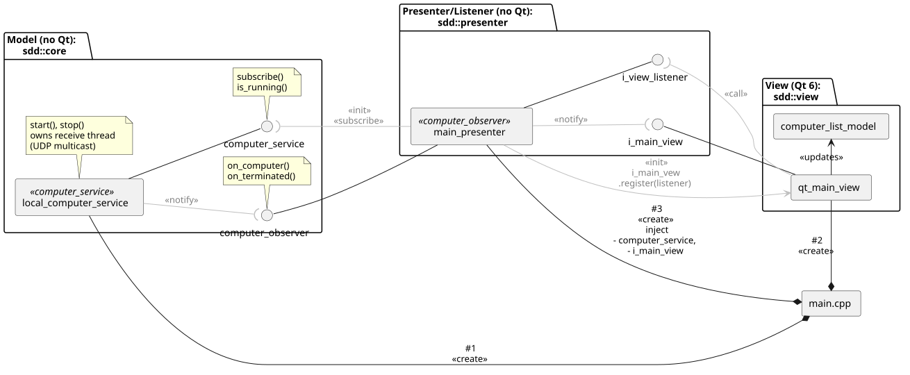
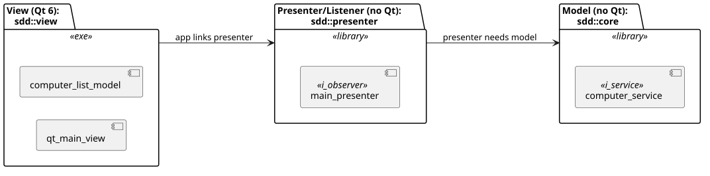
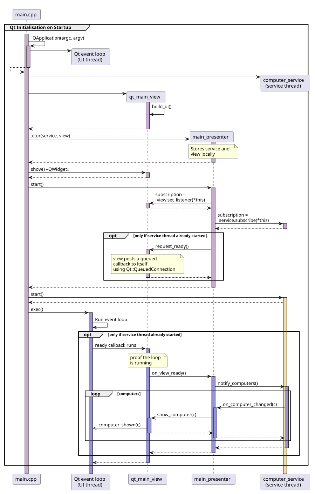
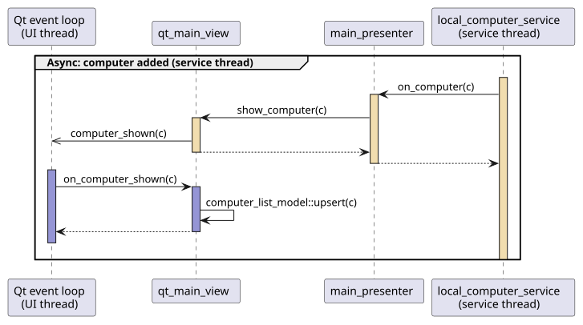
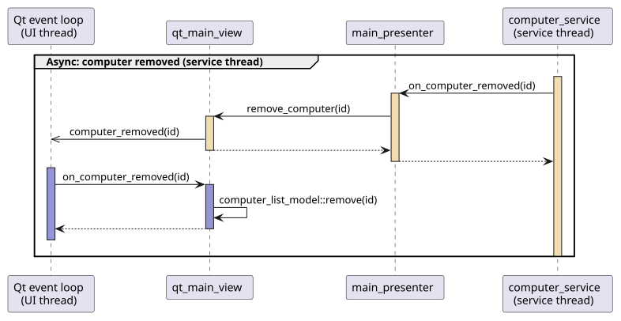
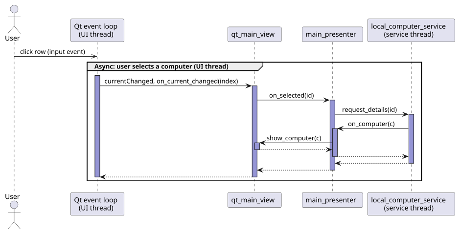

# SDD Monitor: Qt 6 Integration Design <!-- omit in toc -->

- [1. Scope](#1-scope)
- [2. Proof of Concept](#2-proof-of-concept)
- [3. Pattern and Layers](#3-pattern-and-layers)
- [4. Composition Root (`qt6/src/main.cpp`) and MVP Lifecycles](#4-composition-root-qt6srcmaincpp-and-mvp-lifecycles)
- [5. Subscriptions (`sdd::infra`) for Lifecycle Management](#5-subscriptions-sddinfra-for-lifecycle-management)
  - [5.1. Without RAII](#51-without-raii)
  - [5.2. Generic Notifier (`sdd::infra`)](#52-generic-notifier-sddinfra)
  - [5.3. Using a Subscription](#53-using-a-subscription)
- [6. Core API (`sdd::core`)](#6-core-api-sddcore)
  - [6.1. Interfaces for Core](#61-interfaces-for-core)
  - [6.2. Initialisation and Usage](#62-initialisation-and-usage)
- [7. Presenter (`sdd::presenter`)](#7-presenter-sddpresenter)
- [8. View Contract (`sdd::presenter`)](#8-view-contract-sddpresenter)
  - [8.1. Pushing Updates](#81-pushing-updates)
  - [8.2. Listener](#82-listener)
- [9. Qt View (`sdd::view`)](#9-qt-view-sddview)
  - [9.1. Qt Relation between Signals and Slots](#91-qt-relation-between-signals-and-slots)
- [10. Sequences for Views](#10-sequences-for-views)
  - [10.1. A New Computer Discovered](#101-a-new-computer-discovered)
  - [10.2. A Computer Expired / Removed](#102-a-computer-expired--removed)
  - [10.3. User Selecting a Computer](#103-user-selecting-a-computer)
- [11. Directory Layout (target)](#11-directory-layout-target)

## 1. Scope

How the Qt 6 view connects to the business-logic library `sdd::core`. Out of
scope: discovery protocol, timeouts, and property contents.

Drivers:
- `sdd::core` has no Qt headers and runs its own threads.
- Computers are added, updated, and removed asynchronously. The view receives
  these by push, not polling.
- Properties are queried on demand. Answers arrive asynchronously.

## 2. Proof of Concept

A throwaway proof of concept in [poc/](../poc/) builds this integration with a
mock presenter. It has no `sdd::core` and no removals. Build and run it with:

```sh
cmake -S poc -B build/poc && cmake --build build/poc
./build/poc/src/qt6/sdd_monitor_poc
```

The mock presenter's service thread announces two computers, answers each
selection after a delay, and the view updates by signal.

The design has been updated since the PoC, and they do not match. But it serves
as a general mechanism, augmenting knowledge where this DESIGN might not cover
some specific implementation details.

## 3. Pattern and Layers

The design uses **Model-View-Presenter (MVP)**:

- **Model**: `sdd::core`. Owns the computer data and the discovery threads.
  Knows nothing about the presenter or the view.
- **Presenter**: `sdd::presenter`. The only class that knows both sides. It
  translates model events into view calls and view events into model requests.
- **View**: `sdd::view`. Passive. It displays what the presenter pushes and
  forwards user input. It never reads the model.

Why MVP and not MVC: in MVC the view observes the model directly. Here that
would make the Qt view depend on `sdd::core` and on its threading. In MVP, the
model's only dependency is its observer interface, which the presenter
implements. The view can be replaced without touching the model or the presenter
logic.

| Role / target                | Contents                                           | Qt? | Threads        |
| ---------------------------- | -------------------------------------------------- | --- | -------------- |
| Infrastructure: `sdd::infra` | `subscription`                                     | no  | none           |
| Model: `sdd::core`           | `computer`, `i_service`, `computer_service`        | no  | service thread |
| Presenter: `sdd::presenter`  | `main_presenter`, `i_main_view`, `i_view_listener` | no  | none           |
| View: `sdd::view`            | `qt_main_view`, `computer_list`                    | yes | UI thread      |
| Composition root: `app`      | `main.cpp`                                         | yes | UI thread      |

Rules:
- Only `sdd::view` and `app` include Qt headers.
- The presenter has no thread code. The view handles marshalling.
- The model never calls the view. It calls only the observer it was given.



The package dependencies, implemented by the build system as executables and
libraries that are linked. The view explicitly requires the presenter, the
presenter explicitly requires the model. The transitive dependencies allow
everything to be linked. The build system prevents the view from including any
headers from the model.



The `sdd::infra` is not shown in these diagrams - it contains utility functions
that can be used across all layers (as it provides application agnostic
functions, like subscriptions) across all layers.

## 4. Composition Root (`qt6/src/main.cpp`) and MVP Lifecycles

Declaration order sets destruction order (reverse). The subscription is
destroyed first, so no callback can run into a dead view.

```cpp
auto main(int argc, char** argv) -> int {
  QApplication app(argc, argv);
  sdd::core::computer_service service;
  sdd::view::qt_main_view view;
  sdd::presenter::main_presenter presenter(service, view);
  presenter.start(); // subscribe to service
  service.start();
  view.show();
  return app.exec();
}
```

The startup sequence for above is shown below:



On construction, the `presenter.start()` internally subscribes to the service
and the view, holding a subscription object for each.

The constructors do minimal amount of work, and should never throw under common
scenarios (memory allocation issues excluded as they're uncommon).

The startup requires that the `service.start()` is called *after* the
`presenter.start()`, which subscribes to the service and the view. So long as
the service is subscribed to before starting the service thread, no information
can be lost, and so no explicit mechanism is needed to query the already known
computers on startup. Should the design change that this doesn't hold true, an
extension is needed to request an update for all known computers. See the
optional section in the initialisation sequence which isn't required for the
current design.

Destruction is in the reverse order that it is constructed, so destruction is in
the reverse order:

- presenter (it depends on the service and view)
  - The presenter holds a subscription object to the service. When the
    presenter is destroyed, it waits for all inflight callbacks and unsubscribes
    from the service. The service knows the subscription is cancelled through
    its callback stored in the subscription object it gave back, and removes the
    presenter from its internal list of objects to notify.
  - The presenter holds a subscription object also to the view. The inflight
    callbacks from the view to the presenter are completed first, and then
    subscribed so the view no longer notifies the presenter of UI changes.
- view
  - It is no longer holding any references to the presenter, because it
    unsubscribed first.
- service
  - It is no longer holding any references to the presenter, because it
    unsubscribed first.

## 5. Subscriptions (`sdd::infra`) for Lifecycle Management

`subscription` is a move-only RAII handle. Its destructor unsubscribes and
**blocks until in-flight callbacks finish**. Because of that, the observer can
be destroyed after the subscription.

Typical usage looks like this:

```cpp
sdd::core::computer_service service;
sdd::view::qt_main_view view;
sdd::presenter::main_presenter presenter(service, view);

presenter.start();    // calls service.subscribe(*this)
                      // and view.set_listener(*this)

// ... the app runs ...

// presenter goes out of scope here and unsubscribes safely to both the service
// and the view.
```

The important part is that the handle owns the lifetime of the subscription. If
the object holding the `subscription` is destroyed while the service is
executing a callback, the destructor does not simply drop the registration; it
waits for the callback to finish, then cleans up. This makes the observer safe
to tear down without creating a use-after-free race.

The RAII object keeps the correct ordering automatic:

```cpp
class subscription {
 public:
  explicit subscription(std::function<void()> cancel) : cancel_(std::move(cancel)) {}
  ~subscription() { if (cancel_) cancel_(); }
  subscription(subscription&& o) noexcept : cancel_(std::exchange(o.cancel_, nullptr)) {}
  subscription(const subscription&) = delete;
  auto operator=(const subscription&) -> subscription& = delete;
  auto operator=(subscription&&) -> subscription& = delete;
 private:
  std::function<void()> cancel_;
};
```

### 5.1. Without RAII

Without the RAII handle, the same pattern would look like this:

```cpp
service.subscribe(presenter);
// ...
service.unsubscribe(presenter);   // easy to forget or do in the wrong order
```

Forgetting to call `unsubscribe` means the observer keeps receiving events, and
destroying the observer while a callback is still running can race with the
service thread.

### 5.2. Generic Notifier (`sdd::infra`)

In the MVP design, every observer uses the same pattern for managing the
lifetime of the subscriber and maintaining an in-flight counter. The `notifier`
template can then exist in `sdd::infra`. The class `computer_service` uses it
for `i_observer`, and `qt_main_view` uses it for `i_view_listener`:

```cpp
template <typename Listener>
class notifier {
 public:
  [[nodiscard]] auto subscribe(Listener& l) -> subscription {
    {
      std::lock_guard lock(mutex_);
      listeners_.push_back(&l);
    }
    return subscription([this, &l]() {
      {
        std::lock_guard lock(mutex_);
        listeners_.remove(&l);
      }
      std::unique_lock lock(mutex_);
      cv_.wait(lock, [this] { return in_flight_ == 0; });
    });
  }

  template <typename Call>
  auto notify(Call&& call) -> void {
    std::vector<Listener*> snapshot;
    {
      std::lock_guard lock(mutex_);
      ++in_flight_;
      snapshot = {listeners_.begin(), listeners_.end()};
    }
    for (Listener* l : snapshot) call(*l);
    {
      std::lock_guard lock(mutex_);
      --in_flight_;
    }
    cv_.notify_all();
  }

 private:
  std::mutex mutex_;
  std::condition_variable cv_;
  std::list<Listener*> listeners_;
  std::size_t in_flight_ = 0;
};
```

A cancel must not run from inside `notify`, because it waits for `in_flight_`
to reach zero, which can't happen while the cancelling callback is still running.
`notify` iterates over a copy of the registry, so a cancel during a notification
only affects future notifications. The cancel still waits for the current
notification to finish, for all listeners, not just the one being cancelled.

### 5.3. Using a Subscription

A practical implementation is for the service to hold a `notifier` (section 5.2)
for its observers. The subscribe and cancel logic lives in the notifier, so the
service only forwards notifications through it:

```cpp
class computer_service : public i_service {
 public:
  auto subscribe(i_observer& observer) -> subscription override {
    return observers_.subscribe(observer);
  }

  auto notify_changed(const computer& c) -> void {
    observers_.notify([&](i_observer& o) { o.on_computer_changed(c); });
  }

 private:
  sdd::infra::notifier<i_observer> observers_;
};
```

The observer must not be destroyed while a callback is still executing. The
notifier enforces this, because cancelling a subscription waits for all
in-flight notifications on that notifier. In this design, the subscribers have
the lifetime of the presenter object, so this restriction is met.

## 6. Core API (`sdd::core`)

### 6.1. Interfaces for Core

```cpp
// computer.h
using computer_id = std::uint64_t;
using property_map = std::map<std::string, std::string>;   // open-ended key/value
struct computer { computer_id id; std::string hostname, address; property_map properties; };

// i_observer.h
class i_observer {               // called on the service thread
 public:
  virtual auto on_computer_changed(const computer&) -> void = 0;   // add or update
  virtual auto on_computer_removed(computer_id) -> void = 0;
};

// i_service.h
class i_service {
 public:
  [[nodiscard]] virtual auto subscribe(i_observer&) -> subscription = 0;
  virtual auto request_details(computer_id) -> void = 0;        // returns at once; answer via observer
};
```

### 6.2. Initialisation and Usage

`computer_service` adds `start()`. Only the composition root calls them. There
is no `stop()` as this is handled by the destructor.

The `sdd::core` owns:

- the computer data
- the discovery threads
- emits asynchronous changes via `i_observer`

The `main_presenter` implements `i_observer`, which provides the callbacks the
presenter needs so that the UI is updated. The `i_service` calls methods from
the observer when things change.

The main program instantiates an instance of `i_service`, say `computer_service`.
It then injects it into the presenter via the constructor that takes a
`i_service`. Then the presenter will call `i_service.subscribe` to its own
implementation of `i_observer` to get its updates, perhaps even to
itself, if the presenter implements the `i_observer`.

## 7. Presenter (`sdd::presenter`)

The presenter is stateless, except for holding its two subscriptions. Both are
created and cancelled through the `sdd::infra` notifier, so cancelling them in
its destructor stops the service and view calling into the presenter. The
view's cancel runs on the UI thread, so the presenter must be destroyed there
too. It translates between the two interfaces and does no locking.

```cpp
class main_presenter final : public i_observer, public i_view_listener {
 public:
  main_presenter(i_service& s, i_main_view& v) : service_(s), view_(v) {}

  auto start() -> void {
    // Main thread.
    service_subscription_ = service_.subscribe(*this);
    view_subscription_ = view_.set_listener(*this);
  }

  auto on_selected(std::optional<view_id> id) -> void override {
    // On UI thread, i_view_listener
    if (id) service_.request_details(*id);
  }

  auto on_computer_changed(const computer& c) -> void override {
    // On service thread, i_observer
    view_.show_computer(to_view(c));
  }

  auto on_computer_removed(computer_id id) -> void override {
    // On service thread, i_observer
    view_.remove_computer(id);
  }

 private:
  static auto to_view(const computer& c) -> view_computer {
    return {c.id, c.hostname, c.address, c.properties};
  }

  i_service& service_;
  i_main_view& view_;
  subscription view_subscription_;
  subscription service_subscription_;
};
```

## 8. View Contract (`sdd::presenter`)

The view-facing contract is intentionally small. It defines only the operations
that the presenter needs to push state into the UI and the operations that the
UI must send back to the presenter.

### 8.1. Pushing Updates

The view never sees core types. The presenter defines its own DTO, and the view
includes only the presenter headers:

```cpp
// view_computer.h (presenter, no core include)
using view_id = std::uint64_t;
using view_properties = std::map<std::string, std::string>;
struct view_computer { view_id id; std::string hostname, address; view_properties properties; };

class i_main_view {                            // may be called from any thread
 public:
  // Presenter subscribes to be notified of events to an i_view_listener.
  // Caller's thread, before service.start() and before any listener callbacks run.
  // Cancel waits for in-flight on_selected calls (sdd::infra notifier).
  [[nodiscard]] virtual auto set_listener(i_view_listener&) -> subscription = 0;

  virtual auto show_computer(const view_computer&) -> void = 0; // add, or replace by id
  virtual auto remove_computer(view_id) -> void = 0;
};
```

`i_main_view` is implemented by the concrete Qt view. It is the only interface
that the presenter calls to tell the UI to show, update, or remove a computer.

In the concrete design, `qt_main_view` implements `i_main_view` and emits Qt
signals such as `computer_shown` and `computer_removed`. The QObject keeps the
marshalling to the UI thread.

The presenter, on construction, gets a reference to the model `i_service` and
the view `i_main_view`.

### 8.2. Listener

```cpp
class i_view_listener {                        // called on the UI thread
 public:
  virtual auto on_selected(std::optional<view_id>) -> void = 0;
};
```

The presenter implements `i_view_listener` and is registered with the view by
the presenter calling `i_main_view.set_listener(*this)`. The presenter stores the
returned `subscription`, so the view can notify the presenter when the user
changes the selection, and the presenter can cancel that notification on destruction.

## 9. Qt View (`sdd::view`)

`qt_main_view` implements `i_main_view` by emitting signals. With the default
`AutoConnection`, a signal emitted from the service thread queues its slot onto
the UI thread. The view needs no `QThread`, `invokeMethod`, or timer.

The class declares the signals and slots and implements the presenter's removal
path:

```cpp
class qt_main_view : public QMainWindow, public sdd::presenter::i_main_view {
  Q_OBJECT
 public:
  explicit qt_main_view(QWidget* parent = nullptr);

  auto set_listener(sdd::presenter::i_view_listener& l) -> sdd::subscription override;
  auto show_computer(const sdd::presenter::view_computer& c) -> void override;   // any thread
  auto remove_computer(sdd::presenter::view_id id) -> void override;             // any thread

 signals:
  auto computer_shown(const qt_computer& c) -> void;
  auto computer_removed(qulonglong id) -> void;

 private slots:
  auto on_computer_shown(const qt_computer& c) -> void;         // UI thread
  auto on_computer_removed(qulonglong id) -> void;              // UI thread
  auto on_current_changed(const QModelIndex& current) -> void;  // UI thread

 private:
  auto build_ui() -> void;
  computer_list* list_ = nullptr;
  sdd::infra::notifier<sdd::presenter::i_view_listener> listeners_;
};

qt_main_view::qt_main_view(QWidget *parent) : QMainWindow{parent} {
  qRegisterMetaType<qt_computer>();                                                      // before any queued connect
  connect(this, &qt_main_view::computer_shown,   this, &qt_main_view::on_computer_shown);    // queued
  connect(this, &qt_main_view::computer_removed, this, &qt_main_view::on_computer_removed);  // queued
  connect(list_->selectionModel(), &QItemSelectionModel::currentChanged,
          this, &qt_main_view::on_current_changed);                                      // UI thread
  build_ui();
}

auto qt_main_view::set_listener(sdd::presenter::i_view_listener& l) -> sdd::subscription {
  return listeners_.subscribe(l);
}

auto qt_main_view::remove_computer(sdd::presenter::view_id id) -> void {       // any thread
  emit computer_removed(id);
}

auto qt_main_view::on_computer_shown(const qt_computer& c) -> void {    // UI thread
  list_->upsert(c);
}

auto qt_main_view::on_computer_removed(qulonglong id) -> void {         // UI thread
  list_->remove(id);
}

auto qt_main_view::on_current_changed(const QModelIndex& current) -> void {   // UI thread
  const auto id = list_->id_at(current);                              // nullopt if invalid
  listeners_.notify([&](sdd::presenter::i_view_listener& l) { l.on_selected(id); });
}

auto qt_main_view::show_computer(const sdd::presenter::view_computer& c) -> void {    // any thread
  emit computer_shown(qt_computer{c.id, QString::fromStdString(c.hostname),
                                  QString::fromStdString(c.address), to_variant_map(c.properties)});
}
```

The `qt_computer` describes each computer using the Qt language.

```cpp
struct qt_computer { qulonglong id; QString hostname, address; QVariantMap properties; };
Q_DECLARE_METATYPE(qt_computer)   // compile-time; qRegisterMetaType<qt_computer>()
                                  // must also run before queued delivery
```

`computer_list` (`QAbstractListModel`) is the single place rows change:

```cpp
auto computer_list::upsert(const qt_computer& c) -> void {      // UI thread
  const int row = row_of(c.id);
  if (row < 0) {
    beginInsertRows({}, rows_.size(), rows_.size());
    rows_.append(c);
    endInsertRows();
  } else {
    rows_[row] = c;
    emit dataChanged(index(row), index(row));
  }
}

auto computer_list::remove(qulonglong id) -> void {              // UI thread
  const int row = row_of(id);
  if (row < 0) return;
  beginRemoveRows({}, row, row);
  rows_.removeAt(row);
  endRemoveRows();
}

auto computer_list::id_at(const QModelIndex& index) const -> std::optional<sdd::presenter::view_id> {
  if (!index.isValid()) return std::nullopt;
  return rows_[index.row()].id;
}
```

Removal uses `beginRemoveRows`/`endRemoveRows`. If the current row is removed,
Qt emits `currentChanged` with an invalid index. `on_current_changed` then calls
`on_selected(std::nullopt)`, so the presenter learns about the new selection
without extra code.

### 9.1. Qt Relation between Signals and Slots

A signal is declaration only. The Qt metaobject compiler (moc) generate its body. The call

```cpp
emit computer_shown(c);
```

results in every connected slot being called, e.g. the receiver slot
`on_computer_shown` being called as it's connected to the signal.

The slot is an ordinary member function also registered with the moc.

When connecting, the `AutoConnection` causes slots to be called directly if the
emitter is on the same thread as the UI, else it is queued and dispatched.

So when `show_computer` is called from the presenter while on the service
thread, the signal `computer_shown` it is queued, and dispatched from the UI
thread to call `on_computer_shown`.

When `show_computer` is called from the UI thread, the `on_computer_shown` is
called immediately.

## 10. Sequences for Views

### 10.1. A New Computer Discovered



### 10.2. A Computer Expired / Removed



### 10.3. User Selecting a Computer



## 11. Directory Layout (target)

```
sdd-monitor/
├── CMakeLists.txt            top level; project-wide Qt setup, subdirectories
├── infra/
|   ├── CMakeLists.txt
│   ├── src/
|   |   ├── CMakeLists.txt
│   │   ├── include/sdd/      subscription.h
│   │   └── *.cpp; *.h
│   └── test/
|       ├── CMakeLists.txt
│       └── *.cpp; *.h
├── core/
|   ├── CMakeLists.txt
│   ├── src/
|   |   ├── CMakeLists.txt
│   │   ├── include/sdd/      computer.h, i_observer.h, i_service.h
│   │   └── *.cpp; *.h        computer_service.cpp, discovery and query code (to be written)
│   └── test/
|       ├── CMakeLists.txt
│       └── *.cpp; *.h
├── presenter/                sdd_presenter (no Qt)
|   ├── CMakeLists.txt
│   ├── src/
|   |   ├── CMakeLists.txt
│   │   ├── include/sdd/      main_presenter.h, i_main_view.h, i_view_listener.h, view_computer.h
│   │   └── *.cpp; *.h
│   └── test/
|       ├── CMakeLists.txt
│       └── *.cpp; *.h
├── qt6/                      sdd_qt (Qt 6, the only view code)
|   ├── CMakeLists.txt
│   ├── src/
|   |   ├── CMakeLists.txt
│   │   ├── include/sdd/qt/   qt_main_view.h, computer_list.h
│   │   ├── *.cpp; *.h
│   │   └── main.cpp          composition root
│   └── test/
|       ├── CMakeLists.txt
│       └── *.cpp; *.h
└── docs/
    ├── DESIGN.md
    └── assets/
        ├── Makefile
        └── *.puml; *.svg
```

A future Windows (.NET), Qt Bridges, or a GNOME view would be a sibling of
`qt6/` that implements `i_main_view` and calls `i_view_listener`. The libraries
`core/` and `presenter/` would not change.

Each folder `core`, `presenter`, `qt6` generate their own binaries, to ensure
separation between the modules and no usage of internal details.
