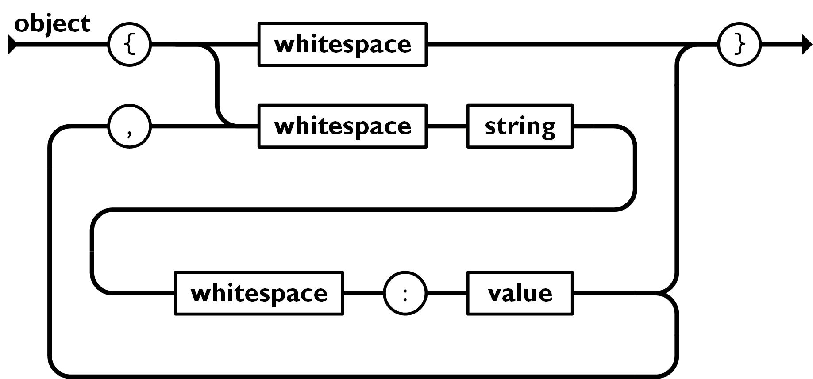
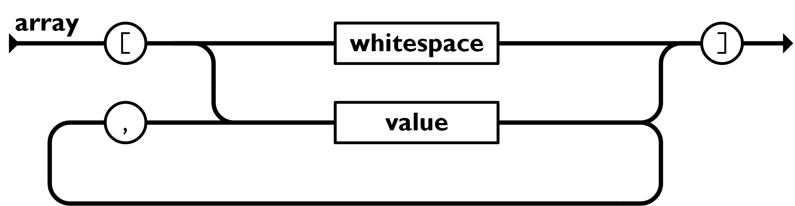
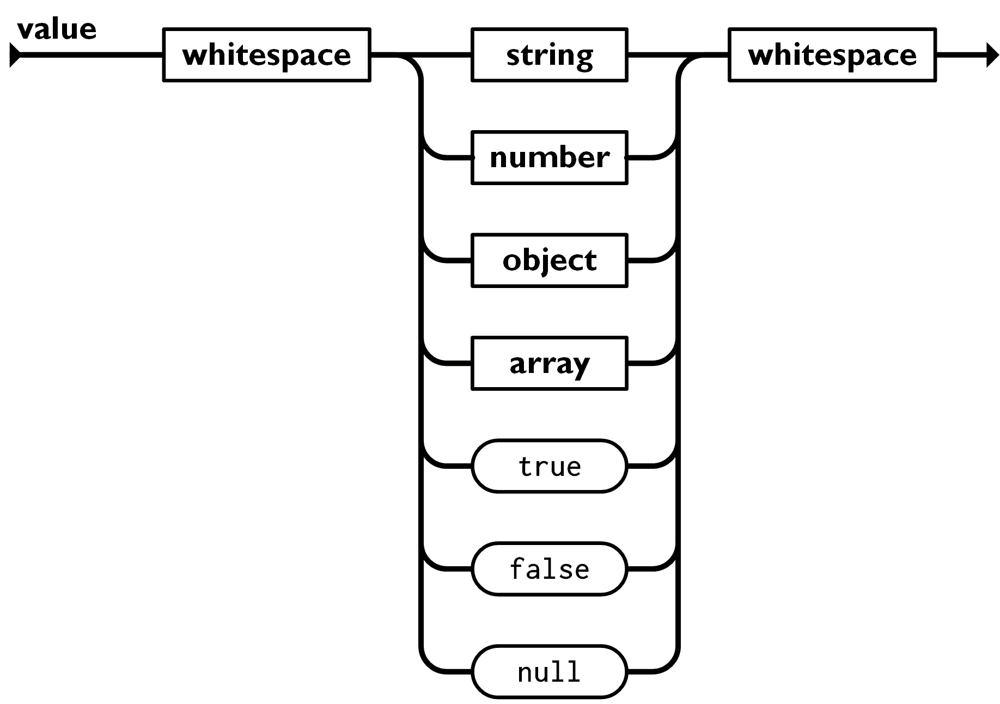
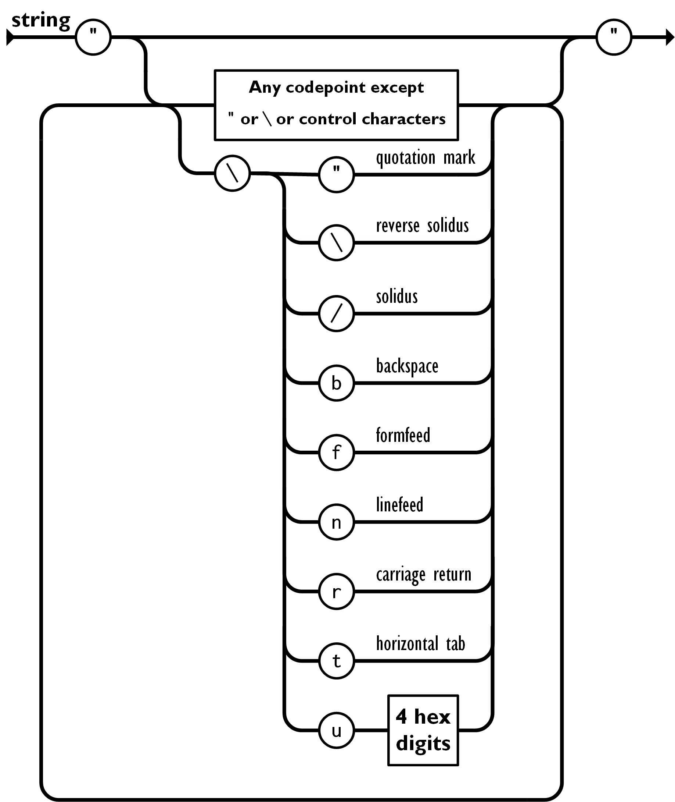
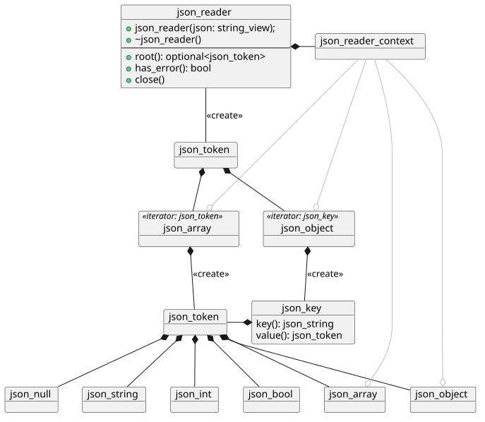
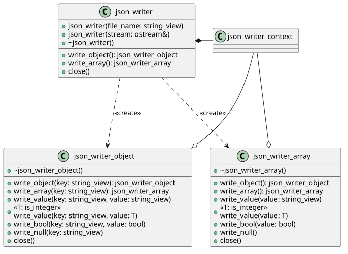

# Simple JSON <!-- omit in toc -->

This library is a small implementation in C++17 to read JSON from a
`string_view` and write JSON to a stream. The class is intended to be simple to
use and check against misuse.

The model of the reader is to parse without a validator, for simple
implementations. Validation is to be done in code.

The model of the writer is to write to a stream without an intermediate DOM
(Document Object Model). It is therefore intended for small implementations
needing also a small writer.

- [1. JSON File Format](#1-json-file-format)
- [2. Dependencies](#2-dependencies)
- [3. Reader](#3-reader)
  - [3.1. Deviations from the Standard when Reading](#31-deviations-from-the-standard-when-reading)
  - [3.2. Usage](#32-usage)
    - [3.2.1. Inputs](#321-inputs)
    - [3.2.2. Exceptions](#322-exceptions)
  - [3.3. Class Design](#33-class-design)
    - [3.3.1. JSON Class Diagram](#331-json-class-diagram)
    - [3.3.2. Class Copy Semantics](#332-class-copy-semantics)
    - [3.3.3. Move Semantics](#333-move-semantics)
    - [3.3.4. Memory Management](#334-memory-management)
- [4. Writer](#4-writer)
  - [4.1. Deviations from the Standard when Writing](#41-deviations-from-the-standard-when-writing)
  - [4.2. Usage](#42-usage)
  - [4.3. Class Design](#43-class-design)
    - [4.3.1. JSON Class Diagram](#431-json-class-diagram)
    - [4.3.2. Class Copy Semantics](#432-class-copy-semantics)
    - [4.3.3. Move Semantics](#433-move-semantics)
    - [4.3.4. Memory Management](#434-memory-management)
    - [4.3.5. Checks](#435-checks)

## 1. JSON File Format

The file format is defined by
[RFC-7159](https://datatracker.ietf.org/doc/html/rfc7159). The usage of the
close should flow like the grammar. The class design should enforce the grammar.

<u>Object</u>:

<u>Array</u>:

<u>Value</u>:

<u>String</u>:

## 2. Dependencies

The SJSON library dependencies should be kept only to the standard C++17
runtime.

## 3. Reader

### 3.1. Deviations from the Standard when Reading

When reading JSON input:

- Comments starting with `//` are skipped up to the end of the line.
- Whitespace is ignored. It is the set accepted by `std::isspace` in the C
  locale.
- Strings may contain an unescaped quote of the other type: `"it's"` and `'say
  "hi"'`. Escapes are optional for these quotes.
- Integers may have a `+` or `-` prefix and any number of digits.
- Floats are not supported. A float is an invalid sequence.
- Trailing commas are allowed in arrays and objects.

### 3.2. Usage

Only one class can be instantiated by the user, `json_reader`. The root object
is obtained with the `root()` method, which returns an iterator `json_array` or
`json_object`.

If we continue iterating from the current level, the `json_array` or
`json_object` element returned is skipped, allowing to ignore blocks that
doesn't need parsing.

The iterators are C++17 `input_iterator`s. They support copy operations. The
input string must have a lifetime that exceeds the `json_reader` object and the
iterators. Iterators can be copied, and iterate independently of each other.

#### 3.2.1. Inputs

The JSON to be parsed is expected to be small. The JSON snippet is given to the
`json_reader` as a `string_view`. If a file is opened, it is memory `mmap()`ped,
and accessed still as a `string_view`.

This design does not support streaming inputs as needed. It should be possible
to extend the implementation to use a file that is read on demand (with a
maximum buffer size), as the basic part is providing tokens. Care would need to
be taken with copied contexts, as files typically share the offsets which
wouldn't be copied, but shared, thus two different copies of a context referring
to the same file would interfere.

#### 3.2.2. Exceptions

Generally no exceptions are raised, unless there is a programmatic error in the
sources, allowing one to easily skip the usage of exceptions, terminating on
catastropic (programming) errors.

Checks are made that if multiple iterators are active at the same time (which
aren't copies), advancing one iterator at a parent level raises an exception
when the child iterator is not yet destroyed.

### 3.3. Class Design

#### 3.3.1. JSON Class Diagram

The reader implements parsing of the input string on demand (instead of parsing
everything upfront), returning objects at the current position in the stream.
Nesting of elements within the JSON stream is mirrored with nesting the
iteration of JSON arrays and objects.

In this diagram, we see that the `json_reader` is the root, and the first object
is obtained from there. The first object is expected to be an array or an
object.

From the array or object, one iterates with `json_token` or `json_key`. So that
when iterating an object or a key, one can call a function receiving the
`json_array` or `json_object` and iterate that. When that function returns (the
stack is returned), the iterator in caller would continue.

The internal context, `json_reader_context` is shared between all classes that
iterate and derive from th source. If an iterator is copied, the context is
copied new and a separate copy is owned by the new object through a shared
pointer. The source JSON input is not copied.

#### 3.3.2. Class Copy Semantics

C++17 requires the iterators to be copyable. A copy can be a potentially
expensive operation, so should not be used. In particular, post-increment
operators are expensive for this reason.

#### 3.3.3. Move Semantics

The objects are be movable. This allows moving the objects into function calls,
or into ownership by other classes.

#### 3.3.4. Memory Management

The reader reads from either a caller-owned `string_view`, or a file opened with
`json_reader::open()`. The caller must keep a `string_view` input alive for as
long as the `json_reader` and the objects it returns are in use.

A file is mapped read-only with `mmap()`, and the descriptor is closed straight
away. The mapping is owned by a `std::shared_ptr` in the parse context, which
is shared by the reader, its iterators and the objects it returns. Copies of the
context share the same mapping and never remap the file. The mapping is released
when the last of those objects is destroyed, so the file may be removed after
it is opened.

Internally, the mapping is opened by a function that returns
`stdext::expected<mapped_file, int>`, carrying the Unix `errno` on failure.
`json_reader::open()` converts that error into a `json_reader_error`.

## 4. Writer

### 4.1. Deviations from the Standard when Writing

When writing JSON:

- The `/` should also be escaped. This is the default, change the config to make
  the outputs more readable.

### 4.2. Usage

Only one class can be instantiated by the user. This is the `json_writer`. The
user provides a file name or a stream, which methods write to.

From the root object, we only allow writing either an `object` or an `array`.
The other elements mean only a single instance of a `value` which doesn't make
sense on its own. So the `json_writer` should provide methods to start an
`object` or an `array`.

The JSON file grammar is stacked, like a tree. The classes should allow function
calls to write the JSON object, like a tree in code.

Writing the `array` starts by starting a new array scope, then allows new
objects to be written as per the grammer. Similarly for when writing an
`object`.

The implementation should ensure that if object "1" starts writing an
object/array, resulting in object "2" coming in scope, then trying to write
another object/array from "1" while "2" is active results in an error.

This is unlike a DOM (Document Object Model), where objects are created in
memory first and then organised, relinked, etc. We are not writing a DOM.

### 4.3. Class Design

There is the base class `json_writer` which the user instantiates. From this
class, objects or arras are written.

#### 4.3.1. JSON Class Diagram

From the grammar, the following restrictions are placed on this implementation:

- From the `json_writer` object, one can create either:
  - `json_writer_object` for objects (or dictionaries); or
  - `json_writer_array` for writing arrays.

Writing outwrite values is not supported.

Observe that the two objects created from `json_writer` do not have public
constructors for the user.

#### 4.3.2. Class Copy Semantics

The objects are not copyable. The style of writing the JSON file is imperative
and each method writes directly to the output stream.

#### 4.3.3. Move Semantics

The objects should be movable. This allows moving the objects into function
calls, or into ownership by other classes.

Moving into other classes has very little benefit, unless omving the root.
Normally, one would provide a reference to a function call to write, or only
move with the intent that at the end of the function call, the object is closed.
The lifetime of each object crated from the `json_writer` root is expected to be
small, only long enough to write the file.

#### 4.3.4. Memory Management

The three classes that the user sees, `json_writer`, `json_writer_array` and
`json_writer_object` are all placed on the stack. The amount of data they keep
is expected to be small.

The `json_writer` creates an object on the heap, the `json_writer_context`, as a
shared pointer. All classes would keep a copy of this shared pointer. The
context knows how to write to the stream, and checks the correctness of usage.

#### 4.3.5. Checks

When the user creates a new element, say from `json_writer`, a
`json_writer_array` or a `json_writer_object`, then creating any new element
from the root should be disallowed.

That means, we must maintain a context of the current writer. This is the
purpose of the `json_writer_context` class.

The same is for when a new `json_writer_array` or a `json_writer_object` is
created from either an existing array or object.

To do this, the `json_writer` root class maintains a
`std::shared_ptr<json_writer_context>`. This context maintains the ability to
write to a stream.

When the root `json_writer` is closed, the stream is no longer used (it is
flushed, and if the stream is created from the `json_writer`, then the stream is
also closed).

All objects, `json_writer_object` and `json_writer_array` that wants to write to
the stream, must use the `json_writer_context`. So they receive the shared
pointer and the new class keeps a copy of it.

For a class to use the context, it should `register` and receive a token. The
token is what is used to check that the object may write to the context. 

The context internally puts the token onto a stack, so that any writes must come
with the token, and if an unexpected token is received, then there is a
programmatic error in the classes usage.

An original idea was to use a callback function, and the method to be called
should be registered. But this precludes an efficient method of moving classes
(a move would invalidate any callback pointer contexts, because the class is
moved from one context to another, and the old context is now invalid). The move
oeprators would also need to tell the context it has moved. While possible, it's
overhead that isn't needed.
